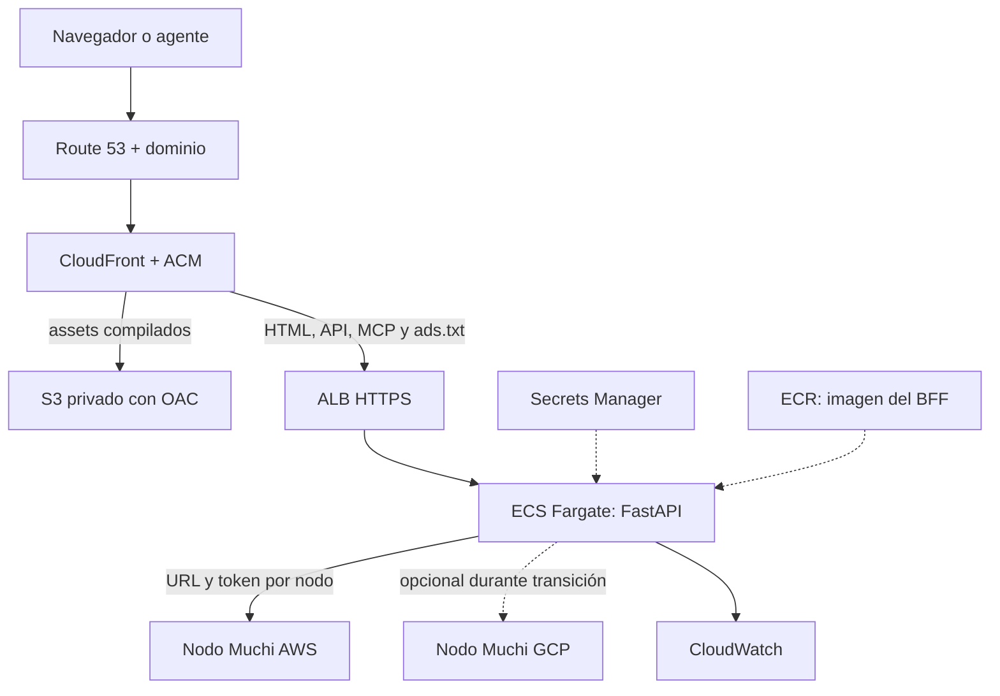

# Propuesta del Front Muchi en AWS

[English](aws-front-proposal.md) | **Español**

Estado: Propuesta para revisión. Fecha: 2026-10-08.

## Objetivo y Dependencias Actuales

Desplegar Vue y su BFF FastAPI en AWS para que el recorrido completo pueda operar
sin infraestructura GCP. Complementa la [propuesta del Nodo API](aws-node-proposal.es.md).
Este documento registra la integración desde muchi-api; los cambios del Front
pertenecen a `metaliaw/muchi`, dueño de su código y arquitectura.

La inspección del checkout local de ese repositorio muestra Firebase Hosting
para publicación estática, Cloud Run para el BFF, Cloud Build y Artifact Registry
para imágenes, Cloud DNS para el dominio y Secret Manager para el token.
`deploy.sh` exige gcloud y Firebase CLI; `cloudbuild.yaml` monta el token con
`latest`. Su cuenta predeterminada participa en build y runtime. Separar esas
identidades en la propuesta AWS y en una futura mejora del despliegue GCP.

El runtime ya usa `MUCHI_API_URL` y `MUCHI_API_TOKEN`. El Dockerfile compila Vue
y sirve FastAPI con Uvicorn; el proceso puede correr en Fargate. La configuración
actual selecciona una API, no un directorio de nodos. MCP usa HTTP sin estado
con respuestas JSON. `/api/config`, `/ads.txt` y la composición del HTML tienen
comportamiento de servidor que debe conservarse.

## Arquitectura Recomendada

CloudFront ofrece un solo Origen público para Vue, BFF y MCP. S3 conserva assets
con nombres por hash y acceso mediante OAC; el bucket no es público. El origen
predeterminado será el BFF para conservar HTML dinámico y rutas SPA. Empezar
sirviendo toda la imagen actual desde Fargate es un piloto válido; extraer assets
a S3 después no cambia el contrato público.

| Dependencia actual | AWS | Cambio requerido |
| --- | --- | --- |
| Firebase Hosting | CloudFront y S3 | Enrutamiento, caché y publicación de assets. |
| Cloud Run | ECS Fargate y ALB | Imagen actual, puerto, salud y cierre ordenado. |
| Cloud Build y Artifact Registry | CI con identidad federada y ECR | Build reproducible y digest por entrega. |
| Cloud DNS | Route 53 | Migración de zona conservando todos los registros. |
| Secret Manager | AWS Secrets Manager | Inyección versionada y activación coordinada. |
| URL GCP de la API | Configuración de nodos | URL AWS y token del lado servidor. |

El certificado de CloudFront debe estar en `us-east-1`; el del ALB se gestiona
en su Región. NIC Chile sigue siendo el registrador: cambiar hosting y DNS no
requiere trasladar el dominio. Véase
[certificados CloudFront](https://docs.aws.amazon.com/AmazonCloudFront/latest/DeveloperGuide/cnames-and-https-requirements.html).

## Paralelo Tecnológico y Fronteras del Front

| GCP actual | AWS desde cero / alternativa | Responsabilidad | Frontera de código o infraestructura | Estado y condición |
| --- | --- | --- | --- | --- |
| Firebase Hosting | S3 + CloudFront | Publicar assets Vue | Build Vue independiente; adaptador de publicación | Build existe; configurar rutas y caché sin credenciales en assets. |
| Cloud Run con Uvicorn | Lambda con adaptador ASGI / Fargate con Uvicorn | Ejecutar aplicación HTTP | Misma aplicación FastAPI; entrada específica del host | Contenedor existe; Lambda propuesto. Verificar lifespan y límites HTTP. |
| Reescrituras Firebase | Behaviors CloudFront + API Gateway / ALB | Enrutar mismo origen | Topología declarativa y contrato público de rutas | No requiere Port Python; preservar métodos, cabeceras y errores. |
| HTML dinámico y rutas FastAPI | Misma aplicación detrás del host AWS | Presentar contenido y configuración pública | `server/main.py`, `server/presenter.py` | Responsabilidad común existente; no sustituir todo HTML por archivos S3. |
| MCP en Cloud Run | MCP sobre adaptador HTTP Lambda / Fargate | Exponer herramientas a agentes | `server/mcp.py` y ciclo de vida de aplicación | HTTP sin estado y JSON existentes; comprobar transporte en nuevo host. |
| API GCP configurada | API AWS o directorio de nodos | Consumir contrato Muchi y elegir propietario | `muchi/api/client.py`, settings y selector de nodo propuesto | Cliente existente; directorio y afinidad durable propuestos. |
| Secret Manager montado en Cloud Run | Secrets Manager inyectado al host | Resolver credencial del Nodo | Settings del cliente API; adaptador de inyección | Mantener Bearer fuera de Vue. Sólo consumidores autorizados. |
| Rotación desde script API GCP | Coordinador común + activadores GCP/AWS | Cambiar credenciales sin perder consumidores | Descriptor del Front y herramienta operativa compartida | Propuesto; incluir BFF como emisor, con versiones concretas por nodo. |
| Cloud DNS | Route 53 | Resolver nombre público | Zona y configuración de despliegue | Infraestructura; preservar registros y ventana de recuperación. |
| TLS gestionado GCP | ACM y TLS del origen | Proteger conexiones | Configuración de borde/origen | No Port de dominio; certificado CloudFront en us-east-1. |
| Cloud Build + Artifact Registry | CI federada + ECR | Construir y publicar entregas | Build/Dockerfile común y adaptadores CI | Separar identidades y conservar digest, assets y versiones. |
| IAM GCP | IAM AWS y roles de ejecución | Autorizar despliegue y lectura de secretos | Política de infraestructura | No trasladar permisos al código de presentación. |
| Logging Cloud Run | CloudWatch | Observar peticiones y fallos | Logs de aplicación comunes; colector del host | Proponer métricas comunes y alarmas específicas del entorno. |
| Escalado a cero Cloud Run | Lambda bajo demanda / Fargate activo | Proveer capacidad | Configuración y adaptador de host | La capacidad no es un servicio de presentación; verificar arranque frío y costo. |

La Abstracción conserva aplicación FastAPI, presentación, cliente del contrato y
configuración pública. Host, publicación, credenciales y selección de nodo se
componen por separado. Una llamada a la API no debe saber dónde se aloja el BFF;
una regla de presentación no debe importar SDKs cloud. Configuración sólo expone
al navegador datos explícitamente públicos.

Criterio de aceptación arquitectónica: ejecutar la misma aplicación con Uvicorn
o entrada Lambda sin bifurcar rutas ni reglas; seleccionar API por configuración
sin cambiar presentación; y desplegar/rotar sin incluir valores secretos en build.
Los adaptadores preservan respuestas, errores, idempotencia y negociación MCP.
Son condiciones para verificar en implementación, no equivalencia demostrada hoy.

## Perfil desde Cero y Runtime del BFF

Fargate con capacidad mínima activa no conserva el despertar HTTP desde cero de
Cloud Run. Para ese Objetivo, evaluar BFF FastAPI en Lambda mediante un adaptador
ASGI detrás de API Gateway y CloudFront. El adaptador traduce eventos y conserva
rutas; presentación y cliente API siguen siendo código común. Mantener el perfil
contenedor como alternativa operativa, sin imponerlo al runtime del producto.

Vue y assets se sirven desde S3/CloudFront sin un proceso propio activo. El HTML
dinámico, `/api/config`, `/ads.txt` y MCP despiertan Lambda. MCP actual es HTTP
sin estado y JSON; aun así, verificar lifespan ASGI, métodos, cabeceras, límites
y timeouts antes de afirmar compatibilidad. No asumir soporte de streaming futuro.
Acotar también las llamadas síncronas al Nodo API y probar inicio en frío.

Separar configuración pública, credenciales inyectadas y adaptador del host.
La imagen Uvicorn y la entrada Lambda construyen la misma aplicación FastAPI.
No leer secretos desde Vue ni depender de estado local para enrutamiento de nodos.
Rotar versiones mediante nuevas entradas/hosts y verificar el consumidor real.
El perfil preferido para evaluar con cómputo desde cero es CloudFront/S3 más BFF
Lambda; el diagrama Fargate anterior conserva el perfil persistente.

## Rutas, Caché y Seguridad

Cachear sólo assets inmutables de la entrega. Desactivar caché para HTML,
`/api/*`, `/mcp`, `/mcp/*` y `/ads.txt` inicialmente. No aplicar una conversión
global de errores 403/404 a `index.html`: ocultaría errores de API y MCP.
La SPA resuelve sus rutas en el BFF como hoy. Publicar todos los assets antes
de activar HTML que los referencia, conservando los de entregas anteriores.

Enviar métodos, query strings y cabeceras necesarias al BFF, incluyendo claves
de idempotencia y cabeceras MCP de negociación y transporte. Verificar Host,
Origin, redirecciones HTTPS y la lista de hosts permitidos de MCP con el dominio
nuevo. Si se habilita streaming después, ajustar y verificar timeouts de toda
la cadena. Véase [comportamientos CloudFront](https://docs.aws.amazon.com/AmazonCloudFront/latest/DeveloperGuide/DownloadDistValuesCacheBehavior.html).

Restringir S3 con OAC y el acceso al ALB para evitar eludir controles del borde.
Usar TLS también al origen, controles de acceso adecuados y roles separados para
CI, ejecución e inyección de secretos. Ningún `VITE_*`, asset, HTML ni respuesta
`/api/config` contiene tokens. Mantener límites públicos del BFF; evaluar límites
compartidos al usar varias réplicas. Véase
[acceso privado a S3](https://docs.aws.amazon.com/AmazonCloudFront/latest/DeveloperGuide/private-content-restricting-access-to-s3.html).

## Selección de Nodo y Secretos

Primera entrega: un BFF AWS apunta únicamente a la API AWS mediante las variables
actuales. Esto permite independencia de GCP sin construir Federación primero.
Después, un directorio interno declara ID, URL, compatibilidad y referencia de
credencial para cada Nodo. El despliegue del Front y el destino API son decisiones
independientes; puede haber conexiones entre nubes durante la transición.

Toda búsqueda conserva `(node_id, search_id)`. Proponer un identificador público
opaco que codifique ambos de forma validada o un mapeo durable compartido por
réplicas; no depender de memoria de proceso. La identidad del nodo se acepta sólo
del directorio autorizado, nunca una URL arbitraria enviada por el navegador.
El mismo origen sirve resultados, cancelaciones y pedidos al Nodo propietario.
Para reintentos de creación incierta, conservar la selección original junto con
la clave de idempotencia. Cambiar a otra API puede duplicar el trabajo; nunca
repetir automáticamente una compra de resultado incierto.

El BFF participa como Emisor en la [gestión común de Secretos](aws-node-proposal.es.md#gestión-común-de-secretos).
En desarrollo, sincronizar la fuente local a destinos GCP y AWS autorizados.
En producción, resolver una credencial por Nodo. Rotar primero validadores API
con doble aceptación, después emisores BFF y finalmente retirar la anterior.
Incluir todas las réplicas y el BFF GCP mientras siga activo. Actualizar el secreto
sin renovar tareas no completa la Rotación. El Front no necesita claves HMAC de
webhooks ni credenciales de base API; el manifiesto debe excluirlas.

La coordinación de secretos conoce referencias y consumidores declarados por
ambos repositorios; no descubre servicios por nombres fijos dentro del script
API. Cada repositorio posee su despliegue y publica su descriptor de consumidores.
AdSense y otros servicios del producto pueden seguir usando proveedores externos;
separar su configuración de la dependencia de hosting GCP.

## Entrega, Transición y Recuperación

1. **Piloto:** definir configuración AWS y consumidores, desplegar la imagen
   actual en ECR/Fargate con Secrets Manager y un dominio de prueba. Apuntar a
   la API AWS; verificar Vue, configuración pública, búsqueda, carrito y MCP.
2. **Publicación:** configurar CloudFront, assets S3, rutas y TLS; separar CI y
   runtime. Publicar BFF compatible antes de activar el Front nuevo y registrar
   digest, assets y versiones de secretos como una Entrega.
3. **Transición:** preservar zona DNS y registros de correo/verificación, reducir
   TTL con antelación y cambiar destino cuando AWS esté listo. Mantener GCP
   operativo durante propagación y ventana de recuperación; retirarlo después
   de verificar tráfico, búsquedas existentes y Rotación.

Volver al hosting anterior no mueve los datos API. Si se desea que ambos BFF
atiendan recursos creados durante la transición, ambos deben conocer el directorio
y formato de identidad de nodos antes del cambio. Sin esa capacidad, mantener
cada entorno accesible para sus recursos y limitar la reversión al Front con
el mismo destino API. Nunca reemplazar el destino de una búsqueda existente.

## Aceptación, Costos y Próximo Paso

La entrega está lista cuando el recorrido AWS funciona con acceso a GCP bloqueado,
Vue usa el mismo origen, MCP negocia correctamente y no se filtran credenciales.
Verificar rutas SPA, errores API reales, ausencia de caché de resultados,
idempotencia, renovación de secretos y reversión sin pérdida de acceso a búsquedas.
Pedidos reales conservan el piloto manual y las restricciones de la API.
Estas son verificaciones futuras; no se construyó ni desplegó el Front aquí.

Presupuestar Fargate, ALB, CloudFront, S3, ECR, logs, secretos y salida de red.
Una API y un BFF pueden compartir ALB con reglas y aislamiento explícitos si
conviene; no duplicar su costo sin comparar. El BFF Fargate mínimo activo no
conserva el escalado a cero de Cloud Run. Acordar disponibilidad, Región, tráfico
y presupuesto antes de dar cifras.

El siguiente Paso es llevar esta Propuesta al repositorio del Front y definir
su configuración de despliegue y descriptor de consumidores, junto al contrato
común de sincronización y Rotación. La API conserva el contrato de negocio;
el Front conserva presentación y adaptación pública.
