# AWS Muchi Frontend Proposal

**English** | [Español](aws-front-proposal.es.md)

Status: Proposal for review. Date: 2026-10-08.

## Objective and Current Dependencies

Deploy Vue and its FastAPI BFF on AWS so the complete journey can operate without
GCP infrastructure. This complements the [API Node proposal](aws-node-proposal.md).
This document records integration from muchi-api; frontend implementation and
architecture belong to `metaliaw/muchi`.

Inspection of that repository's local checkout shows Firebase Hosting for static
publication, Cloud Run for the BFF, Cloud Build and Artifact Registry for images,
Cloud DNS for the domain and Secret Manager for the token. `deploy.sh` requires
gcloud and Firebase CLI; `cloudbuild.yaml` injects the token through `latest`.
Its default identity participates in both build and runtime; separate these
identities on AWS and in a future GCP deployment improvement.

Runtime already accepts `MUCHI_API_URL` and `MUCHI_API_TOKEN`. The Dockerfile
builds Vue and serves FastAPI through Uvicorn, making Fargate viable. Current
configuration selects one API, not a node directory. MCP uses stateless HTTP
and JSON responses. Preserve server behavior in `/api/config`, `/ads.txt` and
HTML composition.

## Recommended Architecture

```mermaid
flowchart TB
    user[Browser or agent] --> dns[Route 53 + domain]
    dns --> cdn[CloudFront + ACM]
    cdn -->|compiled assets| s3[Private S3 with OAC]
    cdn -->|HTML, API, MCP and ads.txt| alb[HTTPS ALB]
    alb --> bff[ECS Fargate: FastAPI]
    secrets[Secrets Manager] -.-> bff
    ecr[ECR: BFF image] -.-> bff
    bff -->|URL and token per node| aws[AWS Muchi Node]
    bff -.->|optional during transition| gcp[GCP Muchi Node]
    bff --> logs[CloudWatch]
```

CloudFront provides one public Origin for Vue, BFF and MCP. S3 stores hashed
assets through OAC with no public bucket access. Default to the BFF origin to
preserve dynamic HTML and SPA routes. Serving the entire existing image through
Fargate is a valid pilot; extracting assets into S3 later preserves the contract.

| Current dependency | AWS | Required change |
| --- | --- | --- |
| Firebase Hosting | CloudFront and S3 | Routing, caching and asset publication. |
| Cloud Run | ECS Fargate and ALB | Existing image, port, health and graceful shutdown. |
| Cloud Build and Artifact Registry | CI with federated identity and ECR | Reproducible build and release digest. |
| Cloud DNS | Route 53 | Zone migration preserving every record. |
| Secret Manager | AWS Secrets Manager | Versioned injection and coordinated activation. |
| GCP API URL | Node configuration | AWS URL and server-side token. |

CloudFront's certificate must reside in `us-east-1`; manage the ALB certificate
in its Region. NIC Chile remains the registrar; changing hosting and DNS requires
no domain transfer. See [CloudFront certificates](https://docs.aws.amazon.com/AmazonCloudFront/latest/DeveloperGuide/cnames-and-https-requirements.html).

## Frontend Technology Mapping and Boundaries

| Current GCP | Zero-minimum AWS / alternative | Responsibility | Code or infrastructure boundary | Status and condition |
| --- | --- | --- | --- | --- |
| Firebase Hosting | S3 + CloudFront | Publish Vue assets | Independent Vue build; publication adapter | Build exists; configure routes/cache without asset credentials. |
| Cloud Run with Uvicorn | Lambda ASGI adapter / Fargate Uvicorn | Execute HTTP application | Same FastAPI application; host-specific entry | Container exists; Lambda proposed. Verify lifespan and HTTP limits. |
| Firebase rewrites | CloudFront behaviors + API Gateway / ALB | Route a single origin | Declarative topology and public route contract | No Python Port required; preserve methods, headers and errors. |
| Dynamic HTML and FastAPI routes | Same application behind AWS host | Present content and public configuration | `server/main.py`, `server/presenter.py` | Existing shared responsibility; do not replace all HTML with S3 files. |
| MCP on Cloud Run | MCP through Lambda HTTP adapter / Fargate | Expose agent tools | `server/mcp.py` and application lifecycle | Stateless HTTP/JSON exists; verify transport on new host. |
| Configured GCP API | AWS API or node directory | Consume Muchi contract and select owner | `muchi/api/client.py`, settings and proposed node selector | Client exists; directory and durable affinity proposed. |
| Secret Manager injected in Cloud Run | Secrets Manager injected into host | Resolve Node credential | API client settings; injection adapter | Keep Bearer outside Vue; authorized consumers only. |
| Rotation from GCP API script | Shared coordinator + GCP/AWS activators | Change credentials without losing consumers | Frontend descriptor and shared operational tool | Proposed; include BFF as issuer with pinned versions per node. |
| Cloud DNS | Route 53 | Resolve public names | Zone and deployment configuration | Infrastructure; preserve records and recovery window. |
| GCP-managed TLS | ACM and origin TLS | Protect connections | Edge/origin configuration | No domain Port; CloudFront certificate in us-east-1. |
| Cloud Build + Artifact Registry | Federated CI + ECR | Build and publish releases | Shared build/Dockerfile and CI adapters | Separate identities; retain digest, assets and versions. |
| GCP IAM | AWS IAM and execution roles | Authorize deployment and secret reads | Infrastructure policy | Never put permissions into presentation code. |
| Cloud Run logging | CloudWatch | Observe requests and failures | Shared application logs; host collector | Propose common metrics and environment-specific alarms. |
| Cloud Run scale-to-zero | On-demand Lambda / active Fargate | Provide capacity | Host adapter and configuration | Capacity is not a presentation service; verify cold start and cost. |

The Abstraction preserves FastAPI application, presentation, contract client and
public configuration. Compose hosting, publication, credentials and node selection
separately. API calls should not know where the BFF runs; presentation rules should
not import cloud SDKs. Browser configuration exposes only explicitly public data.

Architectural acceptance means running the same application through Uvicorn or
Lambda without branching routes/rules, selecting API through configuration without
changing presentation, and deploying/rotating without secret build inputs.
Adapters preserve responses, errors, idempotency and MCP negotiation. These are
implementation checks, not equivalence already demonstrated today.

## Zero-Minimum Profile and BFF Runtime

Fargate with minimum active capacity does not preserve Cloud Run's HTTP activation
from zero. For this Objective, evaluate FastAPI on Lambda through an ASGI adapter
behind API Gateway and CloudFront. The adapter translates events and preserves
routes; presentation and API client remain common code. Retain the container
profile as an operational alternative without imposing it on the product runtime.

Vue assets come from S3/CloudFront without an active application process. Dynamic
HTML, `/api/config`, `/ads.txt` and MCP awaken Lambda. Current MCP is stateless HTTP
and JSON; still verify ASGI lifespan, methods, headers, limits and timeouts before
claiming compatibility. Do not assume future streaming support. Bound synchronous
Node API calls too and verify cold starts.

Separate public configuration, injected credentials and host adapter. Uvicorn and
Lambda entries construct the same FastAPI application. Never read secrets from
Vue or rely on local state for node routing. Rotate pinned versions through new
entries/hosts and verify actual consumers. The preferred profile to evaluate for
zero idle compute is CloudFront/S3 plus Lambda BFF; the earlier Fargate diagram
retains the persistent profile.

## Routes, Caching and Security

Cache only immutable release assets. Initially disable caching for HTML,
`/api/*`, `/mcp`, `/mcp/*` and `/ads.txt`. Avoid global 403/404 conversion into
`index.html`, which would hide API and MCP errors. Preserve BFF handling of SPA
routes. Publish every asset before activating HTML referencing it, retaining
previous release assets.

Forward required methods, query strings and headers, including idempotency keys
and MCP negotiation/transport headers. Verify Host, Origin, HTTPS redirects and
MCP's allowed hosts for the new domain. If streaming is enabled later, adjust
and verify timeouts throughout the chain. See
[CloudFront behaviors](https://docs.aws.amazon.com/AmazonCloudFront/latest/DeveloperGuide/DownloadDistValuesCacheBehavior.html).

Restrict S3 through OAC and ALB access to prevent bypassing edge controls. Use
TLS to the origin, appropriate access controls and separate CI, execution and
secret injection roles. Tokens never enter `VITE_*`, assets, HTML or
`/api/config`. Preserve BFF public limits and assess shared limits across
replicas. See [private S3 access](https://docs.aws.amazon.com/AmazonCloudFront/latest/DeveloperGuide/private-content-restricting-access-to-s3.html).

## Node Selection and Secrets

First delivery: one AWS BFF targets only the AWS API using existing variables.
This provides GCP independence before building Federation. Later an internal
directory declares each Node's ID, URL, compatibility and credential reference.
Frontend hosting and API destination are independent choices; cross-cloud
connections may exist during transition.

Every search retains `(node_id, search_id)`. Propose an opaque public identifier
encoding both with validation, or a durable mapping shared by replicas; avoid
process memory. Accept node identity only from the authorized directory, never
an arbitrary browser-supplied URL. Route results, cancellation and orders to
their owning Node. Preserve original selection alongside the idempotency key
when retrying uncertain creation. Switching API can duplicate work; never
automatically repeat a purchase with an uncertain outcome.

The BFF participates as an Issuer in [shared Secret management](aws-node-proposal.md#shared-secret-management).
Development synchronizes the local source into authorized GCP and AWS destinations.
Production resolves one credential per Node. Rotate API validators with overlapping
acceptance first, BFF issuers second, then retire the previous value. Include all
replicas and the GCP BFF while active. Updating the secret without renewing tasks
does not complete Rotation. The frontend needs neither webhook HMAC keys nor API
database credentials; exclude these from its manifest.

Secret coordination consumes references and consumer declarations from both
repositories; it does not discover services by fixed names in the API script.
Each repository owns deployment and publishes its consumer descriptor. AdSense
and other product services may retain external providers; distinguish their
configuration from GCP hosting dependencies.

## Delivery, Transition and Recovery

1. **Pilot:** define AWS configuration and consumers, deploy the existing image
   through ECR/Fargate with Secrets Manager and a test domain. Target the AWS API;
   verify Vue, public configuration, searches, cart and MCP.
2. **Publication:** configure CloudFront, S3 assets, routes and TLS; separate CI
   and runtime. Publish a compatible BFF before activating the new frontend.
   Record image digest, assets and secret versions as a Release.
3. **Transition:** preserve DNS and email/verification records, lower TTL in
   advance and change destination once AWS is ready. Keep GCP operating during
   propagation and the recovery window; retire it after verifying traffic,
   existing searches and Rotation.

Reverting hosting does not move API data. For both BFFs to serve resources created
during transition, both must understand the node directory and identity format
before cutover. Without this capability, retain access to each environment's
resources and limit frontend rollback to the same API destination. Never replace
an existing search's destination.

## Acceptance, Costs and Next Step

Ready means the AWS journey works with GCP access blocked, Vue uses one origin,
MCP negotiates correctly and credentials never leak. Verify SPA routes, genuine
API errors, uncached results, idempotency, secret renewal and rollback preserving
search access. Real orders retain the API's manual pilot and restrictions.
These are future checks; this work builds or deploys no frontend.

Budget Fargate, ALB, CloudFront, S3, ECR, logs, secrets and network egress. API and
BFF may share an ALB with explicit routing and isolation if appropriate; compare
before duplicating cost. Minimum active Fargate capacity does not preserve Cloud
Run's scale-to-zero behavior. Agree availability, Region, traffic and budget
before quoting amounts.

The next Step is carrying this Proposal into the frontend repository and defining
its deployment configuration and consumer descriptor alongside the shared
synchronization and Rotation contract. The API owns the business contract;
the frontend owns presentation and public adaptation.
