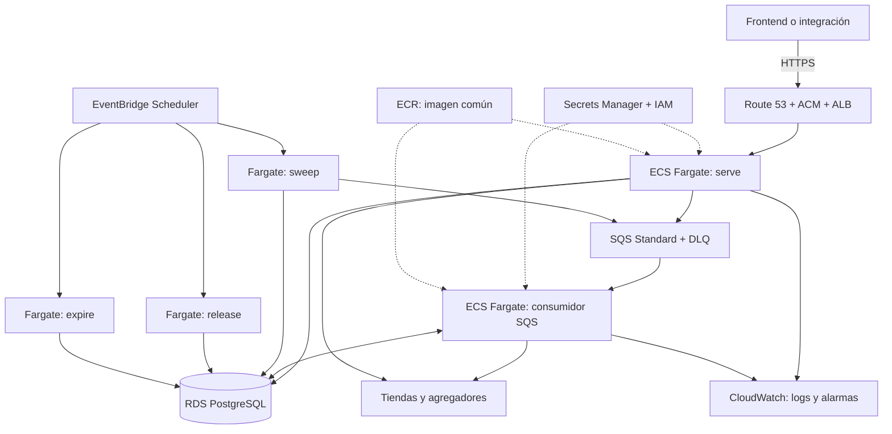

# Propuesta de Nodo Muchi en AWS

[English](aws-node-proposal.md) | **Español**

Estado: Propuesta para revisión. Fecha: 2026-10-08.

El despliegue de Vue y su BFF tiene una [Propuesta complementaria](aws-front-proposal.es.md).

## Estado Implementado del Runtime

La refactorización separa `internal/gcp` de la composición neutral de aplicación.
`BuildRuntime` recibe `Dependencies`; `BuildOperations` comparte Handler, worker,
barrido y liberación entre GCP y CLI. `internal/hosting` controla inicio recuperable
y reutilización. Configuración GCP queda fuera de `config.Config`.
Las entradas existentes y variables de despliegue se conservan.

Las tablas describen el destino AWS; persistencia PostgreSQL, despacho SQS,
entradas Lambda y sincronización/Rotación común de Secretos siguen pendientes.
El diagnóstico de acoplamiento que sigue describe el estado anterior al refactor.

## Objetivo y Alcance

Crear un Nodo AWS que ejecute el mismo contrato de Muchi API y pueda convivir
con el nodo GCP. Cada Nodo posee sus búsquedas, pedidos, caché, cola y secretos.
El código y `config/stores.yaml` se comparten; los datos operativos permanecen
separados. La [arquitectura actual](../architecture.es.md) es la referencia.

Se asume que «otro muchi-nodo» significa una instancia autónoma de la API.
No existe todavía un protocolo de Federación o replicación entre nodos.
La interfaz y su BFF viven en `metaliaw/muchi`; conectarlos requiere trabajo
allá. Una réplica no implica por sí sola recuperación de búsquedas de GCP.

## Arquitectura Recomendada

Usar ECS sobre Fargate para API y workers, SQS para despertares y RDS PostgreSQL
para persistencia. Esta elección conserva transacciones y consultas ordenadas
sin traducir el modelo actual a índices eventualmente consistentes.

| Hoy en GCP | Nodo AWS | Adaptación |
| --- | --- | --- |
| ServeAPI en Cloud Functions | Servicio Fargate detrás de ALB | Reutilizar `serve` y handlers HTTP. |
| ProcessSearch privado | Servicio Fargate con SQS | Nuevo consumidor que llama `Worker.ProcessNext`. |
| Cloud Tasks | SQS Standard y DLQ | Implementar Dispatcher y confirmación de mensajes. |
| Firestore | RDS PostgreSQL | Implementar `repositories.Database` y colecciones. |
| Cloud Scheduler | EventBridge Scheduler | Agregar comandos `sweep`, `release` y `expire`. |
| TTL de Firestore | Borrado periódico acotado | Mantener rechazo lógico de datos vencidos. |
| Secret Manager e identidades | Secrets Manager y roles IAM | Secretos e identidades propios del Nodo. |
| Artefactos y registros | ECR y CloudWatch | Imagen por digest y despliegue reproducible. |

El plazo actual es 1800 segundos. Lambda convencional admite hasta 900;
AWS también documenta Managed Instances con plazos mayores para ciertos modos.
Fargate se recomienda para reutilizar el proceso Go y evitar depender de esa
modalidad. Véase [timeout de Lambda](https://docs.aws.amazon.com/lambda/latest/dg/configuration-timeout.html).

## Paralelo Tecnológico y Responsabilidades de Código

Cada Reemplazo se asigna a una responsabilidad verificable. Una tecnología puede
cumplir varias responsabilidades; varias tecnologías pueden cumplir una misma.
La tabla usa el perfil desde cero como destino principal y conserva Fargate HTTP
como alternativa. «Propuesto» significa que la separación aún no está implementada.

| GCP actual | AWS propuesto | Responsabilidad independiente | Frontera en la base de código | Estado y diferencia que preservar |
| --- | --- | --- | --- | --- |
| Cloud Functions y Functions Framework | Lambda + API Gateway; servidor Fargate alternativo | Recibir HTTP y ejecutar una operación | Handler HTTP común; adaptadores de entrada en `function.go`, Lambda y CLI | Parcial: Handler existe; unificar construcción y separar registro del host. Gateway y función tienen plazos distintos. |
| ProcessSearch invocado por Cloud Tasks | Consumidor SQS en Fargate desde cero | Ejecutar un turno de búsqueda | `search.Worker.ProcessNext`; adaptador convierte mensaje, propietario y resultado | Operación existe; recepción y confirmación SQS propuestas. El turno no conoce SQS ni cabeceras GCP. |
| Cloud Tasks: creación de tareas | SQS: envío de mensajes | Solicitar oportunidades de ejecución | `search.TaskQueue` y `application.Dispatcher`, con adaptadores de despacho | Ports existentes; no copiar el DTO de tarea HTTP al contrato del dominio. |
| Cloud Tasks: ritmo y concurrencia | Límite compartido + escalado ECS | Controlar presión y capacidad | Política de admisión propuesta; `source.TrafficGate` para ritmo por fuente; capacidad en infraestructura | SQS no aplica el mismo ritmo de despacho. Separar admisión de cartas, tráfico por fuente y número de procesos. |
| Cloud Tasks: reintentos HTTP | Visibilidad SQS y DLQ | Confirmar, reintentar y aislar entregas fallidas | Adaptador consumidor; leases y finalización en `ItemStore` | Propuesto para SQS; entrega y lease de negocio siguen siendo garantías distintas. |
| Cloud Functions: instancias bajo demanda | Lambda; alarma SQS + ECS mínimo cero | Activar cómputo cuando llega trabajo | Host y política de infraestructura; configuración de capacidad | Sin Port de negocio para autoscaling. Estado durable permite suspender procesos; medir latencia de despertar. |
| Firestore | RDS PostgreSQL | Persistir y consultar con transacciones | `repositories.Database`, `Collections`, `Repository[T]`; adaptador PostgreSQL | Ports inyectados en `BuildRuntime`; adaptador AWS pendiente. Preservar atomicidad, orden, errores y reintentos. |
| Firestore: leases y transacciones | Transacciones y bloqueos PostgreSQL | Reclamar trabajo y proteger transiciones | `ItemStore`, `OrderStore` y `TrafficGate` sobre Database | Reglas existentes; no delegar propiedad del ítem a la visibilidad SQS. |
| Firestore TTL | Comando `expire` y borrado acotado | Rechazar vencidos y retirar datos | Rechazo actual en repositorios; limpieza mediante operación y Port propuestos | TTL físico es eventual hoy; borrado no debe alterar la validez lógica ni liberar pedidos externos. |
| Cloud Scheduler | EventBridge Scheduler | Disparar mantenimiento periódico | `sweep.Sweeper` y `orders.Releaser`; entradas Lambda/CLI | Operaciones existen; agenda y entrega pertenecen a infraestructura. No agregar scheduler al dominio. |
| Secret Manager | AWS Secrets Manager y fuente local | Publicar/resolver versiones de Secretos | Configuración tipada al runtime; Ports de herramienta de secretos | Parcial: inyección existe; publicación y sincronización común propuestas. El proveedor conserva referencias propias. |
| Revisión Cloud Run y cambio de tráfico | Versión/alias Lambda o definición/tareas ECS | Activar consumidores y verificar Rotación | Coordinador operativo y adaptadores de despliegue propuestos | Separar del almacén de secretos; publicar no demuestra activación. Actualizar emisores y validadores. |
| Cuentas de servicio y OIDC | IAM, roles de ejecución y entrega SQS | Autorizar la entrada y el acceso a recursos | Adaptador de entrada y políticas de despliegue | No sustituir por Bearer compartido de API. No exigir identidad cloud al negocio. |
| Cloud Logging y métricas | CloudWatch | Emitir evidencia operativa | `slog`, métricas comunes y adaptador/exportador | Logs JSON ya existen; traducción de métricas y alarmas propuesta. Evitar nombres de proveedor en eventos de negocio. |
| Artifact Registry y scripts gcloud | ECR y CI/Terraform | Construir, publicar y desplegar artefactos | Dockerfile y lógica de build común; adaptadores operativos | Infraestructura, no servicio de dominio. Registrar digest, versión y ambiente. |
| Red, URL y región GCP | VPC, endpoints y región AWS | Conectar componentes y seleccionar destino | Configuración de adaptadores y directorio de nodos | Separar de políticas de búsqueda; configuración actual mezcla ambos planos. |

### Contrato de Portabilidad

La Composición recibe dependencias y construye operaciones; no abre clientes cloud
por una decisión escondida. Una operación acepta contexto y datos de aplicación,
no eventos Lambda, requests Cloud Tasks o SDKs del proveedor. Cada entrada traduce
éxito, trabajo ausente y falla al protocolo del host. El contexto limita trabajo;
la capacidad del host no se convierte en un valor universal del negocio.

Persistencia, despacho y admisión declaran capacidades mínimas y garantías.
Un adaptador que no puede conservarlas no es un reemplazo equivalente.
El catálogo de fuentes y reglas de presentación permanece compartido. DNS,
autoscaling, CDN, IAM y build se abstraen en configuración o herramientas de
operación, sin fabricar interfaces Go que la aplicación no consume.

Criterio de separación: poder cambiar el host sin modificar `internal/search`,
`internal/orders` o `internal/sweep`; cambiar almacenamiento sin reescribir sus
reglas; y cambiar publicación/activación de secretos sin tocar handlers de negocio.
Esto es un objetivo de diseño, no una garantía ya verificada en el código actual.
La aceptación futura compara los mismos casos de contrato y fallos entre
adaptadores, incluyendo expiración, duplicados, inicio frío y Rotación parcial.

## Persistencia y Consistencia

`BuildRuntime` ahora recibe Ports; `internal/gcp` abre Firestore y Cloud Tasks.
Añadir una composición AWS con otros adaptadores conserva el flujo del dominio.
El nuevo adaptador PostgreSQL implementará `Repository[T]`, `Collections` y
`Database.Transact`; `internal/repositories` conserva las reglas de negocio.

Crear tablas para searches, items, item_offers, requests, orders, offers,
offer_cache, source_health y traffic; la salud puede resolverse con una consulta.
Usar payload JSONB y columnas tipadas para campos consultados, con índices sobre
`available_at`, búsqueda y secuencia de resultados, dominio y pedido externo,
estado de pedido y vencimiento. Derivar el esquema exacto de todas las Query
actuales antes de implementar; no aceptar nombres SQL libres desde HTTP.

Las transacciones deben conservar reclamo exclusivo, lease y propietario,
finalización atómica del ítem y progreso, idempotencia, y transición condicional
del pedido. Usar aislamiento serializable con reintentos acotados o bloqueos
explícitos equivalentes. Un bloqueo de fila durante el reclamo dura solamente
la transacción; consultar tiendas sucede fuera de ella. No añadir
`SKIP LOCKED` sin acordar su efecto sobre el orden actual.

El TTL mantiene 24 horas para búsquedas y los plazos independientes de caché y
pedidos. `expire` borra en lotes acotados sin carreras con transacciones activas.
`release` cambia el estado interno; no cancela automáticamente un pedido externo.
Backups y recuperación a un punto temporal de RDS forman parte de operación.

DynamoDB queda como alternativa si el costo fijo de RDS resulta inaceptable.
Exige rediseñar accesos y reclamos: los GSI ofrecen lectura eventual, por lo que
una sustitución directa arriesga el orden y progreso de la cola.
Véase [consistencia de DynamoDB](https://docs.aws.amazon.com/amazondynamodb/latest/developerguide/HowItWorks.ReadConsistency.html).

## Cola y Recuperación

El mensaje SQS conserva el significado actual: un Despertar, sin ID de ítem.
Recibir una señal llama `ProcessNext`; confirmar después de persistir el
resultado. Un turno sin trabajo confirma la señal; un error transitorio permite
reentrega. Renovar visibilidad mientras se procesa, además del lease en la base.
Si se pierde el lease, cancelar el trabajo y rechazar la finalización.

SQS puede entregar duplicados. La visibilidad no reemplaza al reclamo
transaccional. Configurar DLQ con umbral inicial de cinco recepciones, alarma y
procedimiento de redrive después de corregir el fallo.
Véase [visibilidad y reentrega](https://docs.aws.amazon.com/AWSSimpleQueueService/latest/SQSDeveloperGuide/sqs-visibility-timeout.html).

Comenzar con dos consumidores y una carta simultánea por consumidor. Implementar
un límite compartido de un inicio por segundo; SQS no equivale al rate limiter
de Cloud Tasks. Mantener también el TrafficGate por fuente. Los límites son
por Nodo: dos nodos pueden duplicar la presión sobre una misma tienda.

`sweep` corre cada cinco minutos. Los conteos de SQS son aproximados: reconciliar
con tope y tolerancia, aceptando señales sobrantes. `release` corre cada hora.
EventBridge puede lanzar estas tareas con roles propios y reintentos de
invocación; una invocación aceptada no garantiza que el proceso termine bien.
Alarmar también por salida fallida y ausencia de ejecuciones exitosas.
Véase [tareas programadas ECS](https://docs.aws.amazon.com/AmazonECS/latest/developerguide/tasks-scheduled-eventbridge-scheduler.html).

## Identidad del Nodo y Seguridad

Proponer `aws-br-1` como ID y `sa-east-1` como Región inicial a comparar por
latencia y costo. El dominio real se define con su propietario.
El BFF mantiene un directorio con ID, URL, credencial y compatibilidad del
contrato. Guarda la pareja `(node_id, search_id)` y dirige resultados,
cancelación y pedidos al Nodo de origen. Ante caída puede crear una búsqueda
nueva en otro nodo; no repetir automáticamente una compra incierta.

Cada Nodo usa su propio token Bearer y secreto HMAC. Los tokens quedan en el
BFF; el navegador no recibe credenciales de infraestructura. Registrar webhooks
por tienda para el nodo que crea pedidos. No asumir que una tienda admite varios
receptores: acordar en ese caso un receptor que enrute por pedido y dominio.

ALB público con TLS y API en subredes privadas; RDS sin acceso público.
Workers sólo necesitan salida HTTPS. Presupuestar NAT o una alternativa de
salida, junto con endpoints privados cuando convengan. Roles mínimos separados
para API, worker, tareas y despliegue. `/metrics` permanece fuera de la entrada
pública. Secretos nuevos requieren renovar las tareas que los consumen.

## Runtime Portable y Arranque desde Cero

La propuesta Fargate anterior es un perfil de servicio activo; no garantiza que
una petición HTTP despierte un servicio sin tareas. Fargate puede iniciar procesos
en frío, pero un ALB no aporta por sí solo el despertar y la espera de la primera
petición. ECS admite mínimo cero si una métrica externa detecta demanda; CPU de
tareas inexistentes no proporciona esa señal. Véase
[escalado ECS](https://docs.aws.amazon.com/AmazonECS/latest/developerguide/service-auto-scaling.html).

Si el Objetivo incluye cómputo inactivo hasta recibir trabajo, el perfil preferido
para evaluar pasa a ser API HTTP en Lambda convencional detrás de API Gateway,
SQS y workers Fargate con mínimo cero. Una alarma sobre backlog absoluto despierta
consumidores incluso sin tareas; no dividir por cero al calcular backlog por tarea.
El escalado mantiene máximo dos consumidores y protección de tareas mientras
procesan ítems, con drenaje antes de bajar capacidad. La reconciliación debe
recuperar ítems pendientes aunque falten mensajes. La primera búsqueda paga
latencia de detección, arranque y carga; no prometer un plazo sin medirlo.
Mantenimiento puede ejecutarse en Lambda si se mantiene acotado a su plazo.

La API recibe y persiste rápidamente y responde `202`; las búsquedas de hasta
30 minutos siguen en el proceso worker. Revisar también rutas síncronas de stock,
inventario, cotización y pedidos: Lambda admite hasta 15 minutos, pero el timeout
HTTP del gateway puede ser menor. Acotar llamadas y mantener sus respuestas
actuales cuando quepan; proponer cambios asíncronos de contrato por separado
cuando no quepan. No basta trasladar todas las rutas a Lambda para garantizarlo.
Véase [plazo Lambda](https://docs.aws.amazon.com/lambda/latest/dg/configuration-timeout.html).

PostgreSQL continúa disponible y con costo fijo en este perfil. Controlar conexiones
por instancia y concurrencia Lambda; evaluar pooling/proxy por costo y capacidad.
Escalar cómputo a cero no significa costo cero de almacenamiento, red o control.
DynamoDB y una base que pueda suspenderse requieren evaluación propia; no son
condición para abstraer la ejecución. El diagrama Fargate previo representa el
perfil persistente, y no el perfil desde cero aquí descrito.

### Diagnóstico previo y Fronteras del Código

`function.go` registra Functions Framework, traduce HTTP privado y obtiene el
propietario desde `X-CloudTasks-TaskName`. `BuildRuntime` abre Firestore y Cloud
Tasks directamente; `Config` mezcla variables GCP con políticas del negocio.
Existe una CLI `serve|work`, así que el dominio ya puede ejecutarse fuera de
Cloud Functions. Sin embargo, construir el binario actual no elimina esas
conexiones GCP. La composición HTTP también debe unificarse: CLI y función
no ensamblan hoy exactamente los mismos campos del Handler.

Definir operaciones comunes para construir el Handler, procesar un ítem,
barrer y liberar pedidos. Inyectar Ports de persistencia, despacho y acceso a
fuentes en la composición. Separar configuración de aplicación de configuración
de adaptadores y capacidades de ejecución. Evitar un Provider universal que
intente reproducir toda una plataforma cloud.

Los adaptadores de entrada se limitan a convertir HTTP/eventos y resultados:
Functions Framework para GCP, Lambda para AWS, servidor HTTP y comandos para
contenedores/local. Identidad de invocación y autorización del worker pertenecen
al adaptador; el negocio recibe un propietario opaco y contexto con plazo.
Mantener SDKs cloud fuera del dominio y de las operaciones comunes.

La inicialización usa un contexto de arranque acotado independiente de la primera
petición. Los `sync.Once` actuales conservan para toda la instancia una falla
transitoria de inicio; definir inicialización recuperable y cierre de recursos.
Reutilizar clientes cuando el host permanece caliente, pero nunca depender de
memoria para progreso, leases o secretos vigentes. Leer referencias versionadas
al arrancar y renovar hosts durante Rotación. No dejar trabajo en goroutines
después de responder en un runtime que puede suspender la ejecución.

Siguiente Paso: abstraer composición y operaciones compartidas conservando GCP
como primer adaptador, después conectar almacenamiento/despacho AWS y entradas
Lambda/contenedor. Verificar equivalencia de contrato entre hosts, inicio frío,
reintento tras falla de arranque y recuperación de workers desde cero.
La composición común y el inicio recuperable ya se implementaron; quedan
pendientes los adaptadores AWS y sus verificaciones específicas.

## Gestión Común de Secretos

La Abstracción actual está incompleta. `internal/config` carga `.env` y variables
sin consultar un vendor, pero `get-secret.sh` y `rotate-secret.sh` dependen de
gcloud y duplican la escritura local. Ambos imprimen el valor en stdout.
`deploy-common.sh` fuerza `latest`, y el Handler admite un solo token y un solo
secreto HMAC. No existe coordinación entre nubes ni convivencia de versiones.
El [incidente de rotación](deployment-revisions-secrets.es.md) ya muestra que
publicar una versión no garantiza que el consumidor la esté usando.

Separar tres Responsabilidades: resolver valores al arrancar la aplicación,
publicar versiones mediante adaptadores, y coordinar su activación en consumidores.
El dominio continúa recibiendo configuración tipada; no importa SDK de secretos.
La herramienta operativa tendrá Ports para leer/publicar versiones y para
activar/verificar consumidores, con adaptadores local, GCP y AWS. No todos los
adaptadores tienen que ofrecer generación o rotación automática del proveedor.

Un manifiesto sin valores declara ambiente, secreto lógico, destino, versión y
consumidores autorizados. `api-token`, `order-webhook-secret` y credenciales de
base tienen políticas distintas. Registrar sólo referencias y estados; mantener
valores fuera de Git, imágenes, Terraform state, argumentos y logs. No publicar
hashes de valores como evidencia de igualdad. Usar lectura autorizada y comparación
en memoria, informando únicamente igual o distinto.

### Sincronización desde Desarrollo Local

Proponer una interfaz operativa `secrets plan|sync|rotate|status|resume|rollback`.
Es un contrato por implementar. `sync --environment development --source-file
<RUTA> --targets gcp,aws` toma el secreto local existente como Fuente, sin generar
otro, y publica sus mismos bytes en ambos destinos de desarrollo. Seleccionar
clave lógica, proyecto GCP, cuenta AWS y Región explícitamente; validar la identidad
real antes de escribir. La entrada debe ser un archivo privado fuera del repositorio
o stdin, nunca el valor como argumento. Si se importa desde `.env`, usar un parser,
no ejecutar el archivo como shell; validar formato sin alterar espacios o saltos.

El mismo token puede compartirse entre local y ambos nodos de Desarrollo.
Producción conserva secretos separados por Nodo y se selecciona expresamente.
Sólo sincronizar secretos marcados compartibles: una contraseña de RDS o una
credencial IAM no se copia a GCP por compartir el ambiente. El manifiesto contiene
mapeos de nombres y consumidores, nunca una exportación completa de `.env`.

`plan` muestra destinos y consumidores sin valores. `sync` publica sólo cuando
hay diferencia, registra versiones concretas y verifica ambos destinos.
Una escritura local de `.env` es atómica, con permisos privados y sin duplicar
claves. `get-secret.sh` puede quedar como adaptador de compatibilidad que delega
al flujo común, eliminando impresión del valor por defecto. El arranque local
no sobrescribe silenciosamente las nubes.

### Rotación Coordinada

La Rotación usa un ID de operación y un registro durable sin valores:
`planned → staged → accepting → switched → verified → retired`.
El registro conserva versión anterior y candidata por destino, consumidores,
resultado y plazo de convivencia. Serializar operaciones para un mismo secreto
y ambiente con bloqueo compartido; un bloqueo local no coordina varios operadores.
Generar una sola candidata para secretos compartidos y conservarla en una fuente
privada reanudable. `sync` reutiliza el valor existente; `rotate` crea uno nuevo.

1. **Preparar:** comprobar identidades, permisos, referencias y consumidores,
   guardar versiones anteriores y publicar la candidata en GCP y AWS.
   Fijar versiones concretas; no usar `latest` o `AWSCURRENT` como identidad
   del despliegue. Si falla un destino, detener activación y reanudar el mismo ID.
2. **Activar:** desplegar primero validadores que acepten anterior y candidata,
   comprobarlos, y luego cambiar emisores como el BFF y el entorno local.
   Renovar revisiones GCP y tareas ECS con las referencias concretas; verificar
   preparación y tráfico. La configuración de próximas tareas programadas también
   debe actualizarse. Activar el nuevo valor local después de preparar validadores.
3. **Retirar:** comprobar autenticación y firmas, observar la ventana acordada
   y retirar aceptación de la anterior. Deshabilitarla o quitarle referencias
   según capacidades de cada proveedor; destruir versiones queda para una política
   posterior. Conservar evidencia operativa sin el valor.

La doble aceptación requiere cambiar el Handler actual y su configuración;
no existe hoy. Para Bearer, validar un conjunto acotado con comparación en tiempo
constante y fecha de retiro. El BFF emite sólo el token nuevo después del cambio.
Para HMAC, validar con ambas claves durante la transición y actualizar cada tienda
emisora; registrar pendientes sin mostrar claves. Una tienda sin actualizar impide
marcar la Rotación como terminada. Credenciales de base requieren su propio flujo
de usuario/contraseña y conexiones; no aplicarles automáticamente este protocolo.

ECS inyecta el secreto al iniciar la tarea y exige nuevas tareas para actualizarlo.
Usar roles de ejecución para inyección y roles de tarea sólo si hay lectura en
runtime. Véase [inyección de secretos ECS](https://docs.aws.amazon.com/AmazonECS/latest/developerguide/secrets-envvar-secrets-manager.html).
AWS permite versionar con un token de solicitud idempotente; conservarlo por
operación. GCP necesita reconciliar el registro con las versiones publicadas
antes de reintentar una escritura cuyo resultado fue incierto.
Véase [PutSecretValue](https://docs.aws.amazon.com/secretsmanager/latest/apireference/API_PutSecretValue.html).

No hay transacción atómica entre local, GCP y AWS. Una falla deja estado parcial
visible en `status`; `resume` continúa sin generar otro secreto. `rollback` vuelve
a referencias anteriores y restaura emisores mientras ambos valores son aceptados.
Tras retirar la anterior, reestablecer validadores antes de revertir emisores.
Si la clave fue comprometida, no volver a aceptarla: completar el cambio hacia
una clave segura y asumir la interrupción necesaria.

Criterios adicionales: repetir `sync` sin nuevas versiones innecesarias,
recuperar una falla entre nubes, reanudar tras interrupción del operador,
comprobar consumidores reales y garantizar ausencia de valores en salida.
Verificar rotación con revisiones coexistentes, tienda pendiente, rollback y
separación de desarrollo/producción. Estos casos pertenecen a la implementación
futura; no se leyó ni sincronizó ningún secreto para redactar esta Propuesta.

## Entrega y Criterios de Aceptación

1. **Adaptadores:** implementar sincronización y Rotación común de secretos, seleccionar
   almacenamiento y despacho, implementar PostgreSQL
   y consumidor SQS; añadir comandos de mantenimiento y cierre ordenado.
   Verificar transacciones, expiración, paginación, leases y señales duplicadas.
2. **Infraestructura:** definir Terraform para red, RDS, ECS, ALB, SQS, Scheduler,
   secretos y observabilidad; publicar imagen en ECR y desplegar un piloto.
   Verificar caída de worker, recuperación, DLQ y restauración de backup.
3. **Otro Nodo:** registrar AWS en el BFF, dirigir recursos a su origen y probar
   búsquedas reales con límites conservadores. Habilitar pedidos sólo después de
   un piloto WooCommerce manual y confirmar enrutamiento de webhooks.

Está listo cuando conserva el contrato OpenAPI, completa búsquedas de hasta
30 minutos, evita completar dos veces un ítem y recupera trabajo tras una caída.
También debe rechazar datos vencidos, mantener aislamiento entre nodos y evitar
repetir pedidos por un cambio de destino. Estas son verificaciones propuestas;
esta entrega documental no ejecuta pruebas ni despliega recursos.

## Costos y Decisiones Pendientes

El costo fijo será mayor que un despliegue que escala completamente a cero:
API, consumidores, RDS, ALB y salida de red pueden permanecer activos.
Calcular para 730 horas mensuales: tareas por CPU y memoria, RDS y almacenamiento,
ALB y capacidad, NAT y transferencia, más SQS, secretos, logs, backups y ECR.
Comparar piloto Single-AZ y producción con RDS Multi-AZ y dos réplicas de API;
el piloto no promete alta disponibilidad.

No fijar un monto sin Región, tráfico y disponibilidad acordados.
Usar [precios Fargate](https://aws.amazon.com/fargate/pricing/),
[precios RDS](https://aws.amazon.com/rds/postgresql/pricing/) y AWS Pricing
Calculator antes del despliegue. Definir presupuesto y alarmas desde el piloto.

Pendientes: propietario y cuenta AWS, dominio, volumen de búsquedas, presupuesto,
RPO/RTO, y si el Nodo compartirá tiendas o atenderá un catálogo propio.
El siguiente Paso recomendado es definir el manifiesto de Secretos y la máquina
de estados de sincronización y Rotación, antes de implementar adaptadores o crear
infraestructura. Después sigue el esquema PostgreSQL y sus garantías transaccionales.
