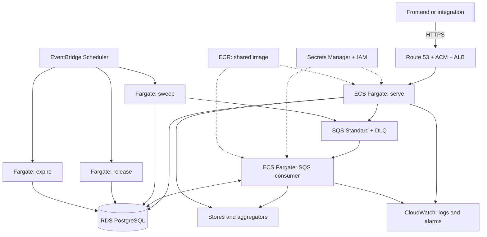

# AWS Muchi Node Proposal

**English** | [Español](aws-node-proposal.es.md)

Status: Proposal for review. Date: 2026-10-08.

Vue and BFF deployment has a [complementary Proposal](aws-front-proposal.md).

## Implemented Runtime Status

The refactor separates `internal/gcp` from neutral application composition.
`BuildRuntime` receives `Dependencies`; `BuildOperations` shares Handler, worker,
sweep and release between GCP and CLI. `internal/hosting` controls recoverable
startup and reuse. GCP configuration lives outside `config.Config`.
Existing entries and deployment variables are preserved.

Tables describe the AWS target; PostgreSQL storage, SQS dispatch, Lambda entries
and shared Secret synchronization/Rotation remain pending. The coupling diagnosis
below describes the state before this refactor.

## Objective and Scope

Create an AWS Node implementing the same Muchi API contract alongside GCP.
Each Node owns its searches, orders, cache, queue and secrets. Code and
`config/stores.yaml` are shared; operational data stays separate.
The [current architecture](../architecture.md) provides the reference.

This proposal interprets “another muchi-node” as an autonomous API instance.
There is currently no Federation or replication protocol. The frontend and BFF
live in `bff/` and `frontend/`; connecting them requires changes there. Another
instance does not automatically recover searches created in GCP.

## Recommended Architecture

Use ECS on Fargate for API and workers, SQS for wakeups and RDS PostgreSQL for
storage. This preserves transactions and ordered queries without translating
the current model into eventually consistent indexes.

| Current GCP component | AWS Node | Adaptation |
| --- | --- | --- |
| ServeAPI on Cloud Functions | Fargate service behind ALB | Reuse `serve` and HTTP handlers. |
| Private ProcessSearch | Fargate service consuming SQS | New consumer calling `Worker.ProcessNext`. |
| Cloud Tasks | SQS Standard and DLQ | Implement Dispatcher and message acknowledgement. |
| Firestore | RDS PostgreSQL | Implement `repositories.Database` and collections. |
| Cloud Scheduler | EventBridge Scheduler | Add `sweep`, `release` and `expire` commands. |
| Firestore TTL | Bounded scheduled deletion | Preserve logical expiry checks. |
| Secret Manager and identities | Secrets Manager and IAM roles | Node-specific secrets and identities. |
| Artifacts and logs | ECR and CloudWatch | Image digest and reproducible deployment. |

The current deadline is 1800 seconds. Conventional Lambda supports up to 900;
AWS also documents Managed Instances with longer deadlines for certain modes.
Fargate is recommended to reuse the Go process without depending on that mode.
See [Lambda timeout](https://docs.aws.amazon.com/lambda/latest/dg/configuration-timeout.html).

## Technology Mapping and Code Responsibilities

Each Replacement maps to a verifiable responsibility. One technology can fulfill
several responsibilities, and several technologies can fulfill one. This table
uses the zero-minimum profile as its main target, retaining HTTP Fargate as an
alternative. “Proposed” means the boundary is not implemented yet.

| Current GCP | Proposed AWS | Independent responsibility | Code boundary | Status and difference to preserve |
| --- | --- | --- | --- | --- |
| Cloud Functions and Functions Framework | Lambda + API Gateway; alternative Fargate server | Receive HTTP and invoke an operation | Common HTTP Handler; `function.go`, Lambda and CLI entry adapters | Partial: Handler exists; unify construction and separate host registration. Gateway and function deadlines differ. |
| ProcessSearch invoked by Cloud Tasks | SQS consumer on zero-minimum Fargate | Execute one search turn | `search.Worker.ProcessNext`; adapter translates message, owner and outcome | Operation exists; SQS reception and acknowledgement proposed. Turns know neither SQS nor GCP headers. |
| Cloud Tasks: task creation | SQS: message publication | Request execution opportunities | `search.TaskQueue`, `application.Dispatcher` and dispatch adapters | Ports exist; do not copy HTTP task DTOs into the domain contract. |
| Cloud Tasks: rate and concurrency | Shared limiter + ECS scaling | Control pressure and capacity | Proposed admission policy; per-source `source.TrafficGate`; infrastructure capacity | SQS lacks equivalent dispatch pacing. Separate card admission, source traffic and process count. |
| Cloud Tasks: HTTP retries | SQS visibility and DLQ | Acknowledge, retry and isolate failed deliveries | Consumer adapter; leases and completion in `ItemStore` | SQS adapter proposed; delivery and business lease guarantees remain distinct. |
| Cloud Functions: on-demand instances | Lambda; SQS alarm + zero-minimum ECS | Activate compute when work arrives | Host and infrastructure policy; capacity configuration | No business autoscaling Port. Durable state permits suspension; measure activation latency. |
| Firestore | RDS PostgreSQL | Persist and query transactionally | `repositories.Database`, `Collections`, `Repository[T]`; PostgreSQL adapter | Ports injected into `BuildRuntime`; AWS adapter pending. Preserve atomicity, ordering, errors and retries. |
| Firestore: leases and transactions | PostgreSQL transactions and locks | Claim work and protect transitions | `ItemStore`, `OrderStore`, `TrafficGate` over Database | Rules exist; never substitute SQS visibility for item ownership. |
| Firestore TTL | `expire` command and bounded deletion | Reject expired records and remove data | Existing repository checks; proposed cleanup operation/Port | Physical TTL is eventual today; deletion must preserve logical validity and never release external orders. |
| Cloud Scheduler | EventBridge Scheduler | Trigger periodic maintenance | `sweep.Sweeper`, `orders.Releaser`; Lambda/CLI entries | Operations exist; schedules and delivery belong to infrastructure rather than domain. |
| Secret Manager | AWS Secrets Manager and local source | Publish/resolve Secret versions | Typed runtime configuration; operational secret tooling Ports | Partial: injection exists; common publication and synchronization proposed. References remain provider-specific. |
| Cloud Run revision and traffic change | Lambda version/alias or ECS definition/tasks | Activate consumers and verify Rotation | Proposed operational coordinator and deployment adapters | Separate from secret storage; publication does not prove activation. Update issuers and validators. |
| Service accounts and OIDC | IAM, execution roles and SQS delivery | Authorize entry and resource access | Entry adapter and deployment policies | Never replace with the shared API Bearer token or require cloud identity in business code. |
| Cloud Logging and metrics | CloudWatch | Emit operational evidence | `slog`, common metrics and adapter/exporter | JSON logs exist; metric translation and alarms proposed. Keep vendor names outside business events. |
| Artifact Registry and gcloud scripts | ECR and CI/Terraform | Build, publish and deploy artifacts | Common Dockerfile/build logic; operational adapters | Infrastructure rather than domain service. Record digest, version and environment. |
| GCP networking, URL and region | VPC, endpoints and AWS region | Connect components and select destination | Adapter configuration and node directory | Separate from search policies; current configuration mixes these planes. |

### Portability Contract

Composition receives dependencies and constructs operations rather than opening
cloud clients through hidden choices. Operations accept context and application
data, never Lambda events, Cloud Tasks requests or provider SDKs. Each entry
translates success, missing work and failure into its host protocol. Context bounds
execution; host capacity is not a universal business value.

Storage, dispatch and admission declare minimum capabilities and guarantees.
An adapter unable to preserve them is not an equivalent replacement. Source
catalog and presentation rules stay shared. Abstract DNS, autoscaling, CDN, IAM
and builds through configuration or operational tooling; avoid Go interfaces
that the application never consumes.

Separation means changing hosts without modifying `internal/search`,
`internal/orders` or `internal/sweep`, changing storage without rewriting their
rules, and changing secret publication/activation without editing business
handlers. This is a design target, not a verified guarantee in current code.
Future acceptance compares the same contract and failure cases across adapters,
including expiry, duplicates, cold starts and partial Rotation.

## Storage and Consistency

`BuildRuntime` now receives Ports; `internal/gcp` opens Firestore and Cloud Tasks.
Adding AWS composition with other adapters preserves the domain flow. The PostgreSQL adapter implements
`Repository[T]`, `Collections` and `Database.Transact`; business rules remain in
`internal/repositories`.

Create tables for searches, items, item_offers, requests, orders, offers,
offer_cache, source_health and traffic; health can use a database query.
Use JSONB payloads and typed query columns, with indexes for `available_at`,
search and result sequence, domain and external order, order status and expiry.
Derive the exact schema from every existing Query before implementation;
never accept arbitrary SQL identifiers from HTTP input.

Transactions preserve exclusive claims, leases and ownership, atomic item
completion and progress, idempotency, and conditional order transitions.
Use serializable isolation with bounded retries or equivalent explicit locking.
Claim locks last only for the transaction; store requests run outside it.
Do not introduce `SKIP LOCKED` without agreeing its effect on current ordering.

Keep 24-hour search expiry and independent cache and order deadlines. `expire`
deletes bounded batches without races against active transactions. `release`
changes internal state; it does not automatically cancel an external order.
RDS backups and point-in-time recovery belong to operations.

DynamoDB is an alternative if RDS fixed costs prove unacceptable. It requires
redesigning access and claims: GSI reads are eventual, making a direct replacement
risky for queue order and progress. See
[DynamoDB consistency](https://docs.aws.amazon.com/amazondynamodb/latest/developerguide/HowItWorks.ReadConsistency.html).

## Queue and Recovery

An SQS message retains its current meaning: a Wakeup without an item ID.
Receiving one calls `ProcessNext`; acknowledge after persisting the result.
A turn with no work acknowledges its signal; transient failure allows redelivery.
Renew message visibility while processing, alongside the database lease.
On lease loss, cancel processing and reject completion.

SQS can deliver duplicates. Visibility does not replace transactional claims.
Start with a DLQ threshold of five receives, an alarm and a redrive procedure
after fixing the cause. See
[visibility and redelivery](https://docs.aws.amazon.com/AWSSimpleQueueService/latest/SQSDeveloperGuide/sqs-visibility-timeout.html).

Start with two consumers processing one card each. Implement a shared limit of
one start per second; SQS does not provide Cloud Tasks' dispatch rate limiter.
Retain per-source TrafficGate. These limits apply per Node: two nodes may double
pressure on a shared store.

Run `sweep` every five minutes. SQS counts are approximate: reconcile with a
cap and tolerance, accepting surplus signals. Run `release` hourly.
EventBridge launches these tasks with separate roles and invocation retries;
an accepted invocation does not guarantee successful process completion.
Alarm on failed exits and missing successful executions too. See
[ECS scheduled tasks](https://docs.aws.amazon.com/AmazonECS/latest/developerguide/tasks-scheduled-eventbridge-scheduler.html).

## Node Identity and Security

Propose `aws-br-1` as the ID and `sa-east-1` as the initial Region to compare by
latency and cost. Agree the actual domain with its owner. The BFF maintains a
directory containing ID, URL, credential and contract compatibility. It stores
`(node_id, search_id)` and routes results, cancellation and orders to their
origin Node. During outages it may create a new search elsewhere; never
automatically repeat a purchase with an uncertain outcome.

Each Node has its own Bearer token and HMAC secret. Tokens stay in the BFF;
browsers receive no infrastructure credentials. Register store webhooks for
the Node creating orders. Do not assume a store supports multiple receivers;
where necessary agree a receiver routing by external order and domain.

Use a public TLS ALB, private API subnets and nonpublic RDS. Workers need outbound
HTTPS only. Budget NAT or another egress design, plus private endpoints where
appropriate. Separate least-privilege roles for API, workers, maintenance and
deployment. Keep `/metrics` off public ingress. Renew tasks when secrets change.

## Portable Runtime and Starting from Zero

The earlier Fargate proposal is an active-service profile; it does not guarantee
that HTTP requests awaken a service with no tasks. Fargate can start cold processes,
but an ALB alone provides neither activation nor waiting for the first request.
ECS supports a zero minimum when an external metric detects demand; CPU from
nonexistent tasks cannot provide that signal. See
[ECS scaling](https://docs.aws.amazon.com/AmazonECS/latest/developerguide/service-auto-scaling.html).

If the Objective includes idle compute until work arrives, the preferred profile
to evaluate becomes conventional Lambda HTTP API behind API Gateway, SQS and
Fargate workers with a zero minimum. An absolute backlog alarm awakens consumers
even without tasks; avoid division by zero in backlog-per-task calculations.
Keep at most two consumers, protect tasks while processing and drain before
scaling in. Reconciliation must recover pending items even with missing messages.
The first search pays detection, startup and loading latency; measure before
promising a deadline. Maintenance can use Lambda if bounded to its deadline.

The API persists quickly and returns `202`; searches lasting up to 30 minutes
remain in workers. Review synchronous stock, inventory, quote and order routes
too: Lambda supports up to 15 minutes, but gateway HTTP timeouts may be shorter.
Bound calls and retain existing responses where they fit; propose asynchronous
contract changes separately where they do not. Simply moving every route to
Lambda does not guarantee compatibility. See
[Lambda deadline](https://docs.aws.amazon.com/lambda/latest/dg/configuration-timeout.html).

PostgreSQL remains available with fixed cost in this profile. Bound connections
per instance and Lambda concurrency; evaluate pooling/proxy by cost and capacity.
Zero compute does not mean zero storage, networking or control costs. DynamoDB
and databases supporting suspension require their own evaluation; neither is a
prerequisite for abstracting execution. The previous Fargate diagram represents
the persistent profile rather than this zero-minimum profile.

### Earlier Diagnosis and Code Boundaries

`function.go` registers Functions Framework, translates private HTTP and derives
ownership from `X-CloudTasks-TaskName`. `BuildRuntime` directly opens Firestore and
Cloud Tasks; `Config` mixes GCP variables with business policies. The `serve|work`
CLI already runs the domain outside Cloud Functions, but building today's binary
does not eliminate its GCP connections. Unify HTTP composition too: CLI and
function currently do not assemble exactly the same Handler fields.

Define common operations to construct the Handler, process an item, sweep and
release orders. Inject persistence, dispatch and source Ports in composition.
Separate application configuration from adapter configuration and execution
capabilities. Avoid a universal Provider reproducing an entire cloud platform.

Entry adapters only translate HTTP/events and outcomes: Functions Framework for
GCP, Lambda for AWS, HTTP server and commands for containers/local. Invocation
identity and worker authorization belong to adapters; business receives opaque
ownership and a deadline context. Keep cloud SDKs outside the domain and shared
operations.

Initialize with a bounded startup context independent of the first request.
Current `sync.Once` values retain transient startup failures for the instance's
lifetime; define recoverable initialization and resource cleanup. Reuse clients
while hosts stay warm, but never rely on memory for progress, leases or current
secrets. Read pinned references at startup and renew hosts during Rotation.
Never leave background work after responding on a host that may suspend execution.

Next Step: abstract composition and shared operations with GCP as the first
adapter, then attach AWS storage/dispatch and Lambda/container entries. Verify
contract equivalence across hosts, cold starts, retry after startup failure and
worker recovery from zero. Shared composition and recoverable startup are now implemented; AWS adapters
and their specific checks remain pending.

## Shared Secret Management

The current Abstraction is incomplete. `internal/config` reads `.env` and
variables without a vendor dependency, but `get-secret.sh` and `rotate-secret.sh`
depend on gcloud and duplicate local writes. Both print secret values to stdout.
`deploy-common.sh` forces `latest`, and the Handler accepts one token and one HMAC
secret. There is no coordination across clouds or overlapping versions.
The [rotation incident](deployment-revisions-secrets.md) already demonstrates
that publishing a version does not mean a consumer uses it.

Separate three Responsibilities: resolving application startup values, publishing
versions through adapters, and coordinating consumer activation. The domain
continues receiving typed configuration without secret SDK imports. Operational
tooling declares Ports for reading/publishing versions and activating/verifying
consumers, with local, GCP and AWS adapters. Adapters need not all support
provider-generated or automatic rotation.

A manifest without values declares environment, logical secret, destination,
version and authorized consumers. `api-token`, `order-webhook-secret` and database
credentials have different policies. Record references and states only; keep
values outside Git, images, Terraform state, arguments and logs. Do not publish
value hashes as equality evidence. Compare authorized reads in memory and report
only equal or different.

### Synchronizing from Local Development

Propose `secrets plan|sync|rotate|status|resume|rollback` as an operational
interface to implement. `sync --environment development --source-file <PATH>
--targets gcp,aws` takes the existing local secret as its Source, generating
nothing, and publishes identical bytes to both development destinations.
Explicitly select logical key, GCP project, AWS account and Region; verify actual
identity before writing. Input uses a private file outside the repository or
stdin, never a value argument. Importing `.env` requires a parser rather than
shell execution; validate without changing whitespace or newlines.

The same token may be shared by local and both Development nodes. Production
retains separate per-Node secrets and explicit selection. Synchronize only keys
marked shareable: RDS passwords and IAM credentials do not belong in GCP merely
because they share an environment. The manifest maps names and consumers;
it never exports all of `.env`.

`plan` displays destinations and consumers without values. `sync` publishes only
on differences, records concrete versions and verifies both destinations.
Local `.env` writes are atomic, private and free of duplicate keys.
`get-secret.sh` may become a compatibility adapter delegating to this flow,
removing value output by default. Local startup never silently overwrites clouds.

### Coordinated Rotation

Rotation uses an operation ID and durable record without values:
`planned → staged → accepting → switched → verified → retired`.
Record previous and candidate versions per destination, consumers, results and
an overlap deadline. Serialize operations for each secret/environment with a
shared lock; a local lock does not coordinate multiple operators. Generate one
candidate for shared secrets and retain it in a private resumable source.
`sync` reuses a value; `rotate` generates a new one.

1. **Prepare:** check identities, permissions, references and consumers; record
   previous versions and publish the candidate in GCP and AWS. Pin concrete
   versions rather than treating `latest` or `AWSCURRENT` as deployment identity.
   If one destination fails, stop activation and resume the same operation ID.
2. **Activate:** first deploy validators accepting previous and candidate values,
   verify them, then switch issuers such as the BFF and local environment.
   Renew GCP revisions and ECS tasks with concrete references; verify readiness
   and traffic. Update definitions for future scheduled tasks too. Activate the
   new local value after validators are ready.
3. **Retire:** verify authentication and signatures, observe the agreed overlap
   window, then stop accepting the previous value. Disable it or remove references
   according to provider capabilities; destruction follows a later retention
   policy. Keep operational evidence without values.

Overlapping acceptance requires changes to the current Handler and configuration;
it does not exist today. For Bearer tokens, validate a bounded set using constant-time
comparison and a retirement deadline. The BFF emits only the new token
following cutover. For HMAC, verify with both keys during transition and update
every emitting store; track outstanding stores without displaying keys.
An unchanged store prevents declaring rotation complete. Database credentials
require a separate user/password and connection workflow; do not automatically
apply this protocol to them.

ECS injects secrets at task startup and requires new tasks for updates.
Use execution roles for injection and task roles only for runtime reads. See
[ECS secret injection](https://docs.aws.amazon.com/AmazonECS/latest/developerguide/secrets-envvar-secrets-manager.html).
AWS supports version publication with an idempotent request token; retain it per
operation. GCP requires reconciling the record against published versions before
retrying a write with an uncertain outcome. See
[PutSecretValue](https://docs.aws.amazon.com/secretsmanager/latest/apireference/API_PutSecretValue.html).

There is no atomic transaction spanning local, GCP and AWS. Failures leave partial
state visible in `status`; `resume` continues without generating another secret.
`rollback` restores previous references and issuers while both values are accepted.
After retiring the previous value, restore validators before reverting issuers.
If the key was compromised, never accept it again: complete the transition to a
safe key and accept any necessary interruption.

Additional acceptance cases: repeated `sync` without unnecessary versions,
recovery between cloud writes, resuming after operator interruption, verification
of actual consumers and no values in output. Verify rotation with overlapping
revisions, an outstanding store, rollback and development/production separation.
These checks belong to future implementation; drafting this Proposal read or
synchronized no secret values.

## Delivery and Acceptance

1. **Adapters:** implement shared secret synchronization and rotation, select
   storage and dispatch, implement PostgreSQL and SQS
   consumption; add maintenance commands and graceful shutdown. Verify
   transactions, expiry, pagination, leases and duplicate signals.
2. **Infrastructure:** define Terraform for networking, RDS, ECS, ALB, SQS,
   Scheduler, secrets and observability; publish an ECR image and deploy a pilot.
   Verify worker failure, recovery, DLQ and backup restoration.
3. **Another Node:** register AWS in the BFF, route resources to their origin and
   exercise real searches with conservative limits. Enable orders after a manual
   WooCommerce pilot and confirmation of webhook routing.

Ready means preserving OpenAPI, completing searches lasting up to 30 minutes,
avoiding duplicate item completion and recovering work after failure.
It also requires rejecting expired data, isolating nodes and avoiding repeated
orders when changing destinations. These are proposed checks; this documentation
delivery runs no tests and deploys no resources.

## Costs and Open Decisions

Fixed costs exceed a deployment that fully scales to zero: API, consumers,
RDS, ALB and network egress may remain active. Calculate for 730 hours monthly:
task CPU and memory, RDS and storage, ALB and capacity, NAT and transfer, plus
SQS, secrets, logs, backups and ECR. Compare a Single-AZ pilot with production
using RDS Multi-AZ and two API replicas; the pilot promises no high availability.

Do not quote an amount without an agreed Region, traffic and availability.
Use [Fargate pricing](https://aws.amazon.com/fargate/pricing/),
[RDS pricing](https://aws.amazon.com/rds/postgresql/pricing/) and AWS Pricing
Calculator before deployment. Set a budget and alarms from the pilot onward.

Open: owner and AWS account, domain, search volume, budget, RPO/RTO, and whether
the Node shares stores or serves its own catalog. The next recommended Step is defining the Secrets manifest and synchronization
and Rotation state machine before implementing adapters or creating infrastructure.
PostgreSQL schema and transaction guarantees follow.
