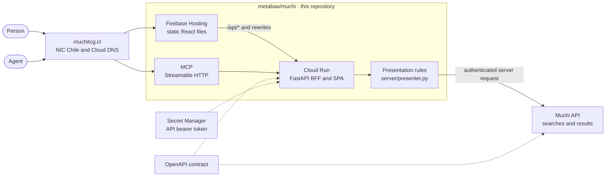
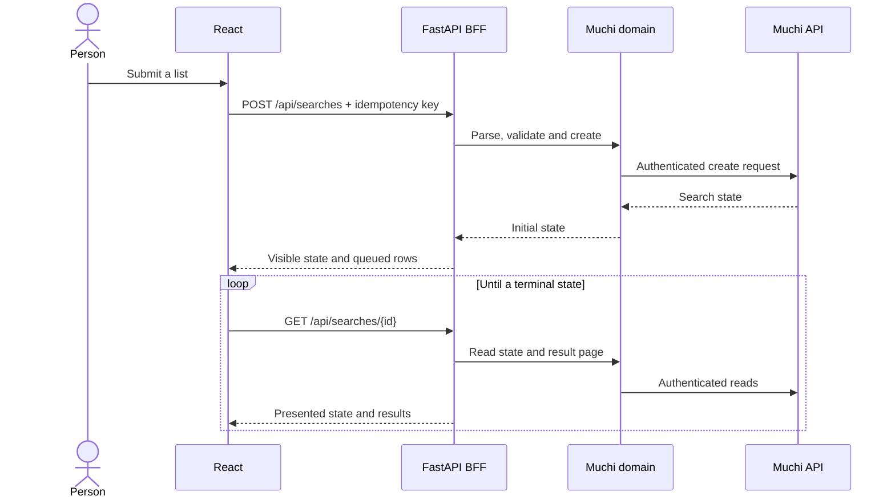

[English](architecture.md) · [Español](architecture.es.md)

# Muchi BFF Architecture

Muchi's React experience, FastAPI Backend-for-Frontend (BFF), and API
implementation live in this repository. The API can run as a separate service
for search collection, queueing, workers, persistence, expiration and recovery.
This page describes the browser-facing boundary and service flow.

## The Public Request Path

Cloud DNS resolves the public name. Firebase Hosting serves the compiled
interface and sends `/api/*` requests to the BFF. The BFF validates public
inputs, calls the Muchi domain, and uses the server-side API credential for
requests across the repository boundary. React never receives that credential.
The same service exposes MCP at `/mcp/` for agents. Its tools create Searches
and read their Results through the Muchi domain, using the same token and API
as the website.

## Why the BFF Exists

The BFF keeps API authentication out of the browser and gives React response
shapes that already match the interface. It also owns public limits and
presentation decisions such as offer ordering, stock labels and cart output.
These rules are visible in [`bff/server/main.py`](../bff/server/main.py) and
[`bff/server/presenter.py`](../bff/server/presenter.py), rather than hidden in a
compiled client bundle.

The BFF is not the search engine. It delegates search, stock and result
operations to the Muchi domain, which calls the API service. Queue dispatch,
workers, persistence, TTL and queue recovery sit behind that service boundary
in this codebase. The [API integration guide](api/README.md) documents the
client, service roles and response shapes.

## A Search Through the BFF

The search API persists slow work before it responds. The BFF returns an
initial state, then combines state and result pages during polling. The
idempotency key makes an uncertain create retry safe; the API owns worker
idempotency and queue behavior.

## BFF Entry Points

Each public route has its own explanation of its purpose, input and boundary
in the [BFF entry-point guide](bff/README.md). The index is arranged by the
task each route enables, from serving the React application to creating and
presenting searches.

## Security and Operations

The browser calls the BFF from the same public origin as the application. The
BFF validates request shapes and keeps the bearer token in its server runtime.
The API authenticates protected calls. Worker and scheduler identities are
outside the BFF process and are described in the
[API integration guide](api/README.md).

Cloud Run can scale the BFF to zero, trading idle cost for a cold start on the
first request. Monitor BFF latency, errors, downstream API failures, secret
access and health. The independent backend queue, worker and source metrics
belong to the API's operational guide.

## Deployment Boundary

The deployment script builds and deploys the BFF before publishing the new
static Frontend. This order lets a new interface call routes the live BFF
already understands. The API service may deploy separately; its compatibility
with the local client is described in the
[API integration guide](api/README.md).

See [`deploy.sh`](../deploy.sh), [`cloudbuild.yaml`](../cloudbuild.yaml), and
the [Frontend and its boundary](web-migration.md) for this repository's
deployment details. The [MCP guide](mcp.md) describes its tools and connection.
